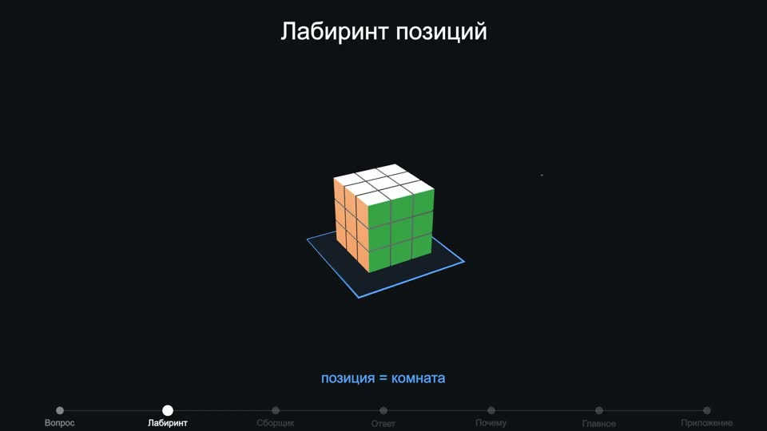
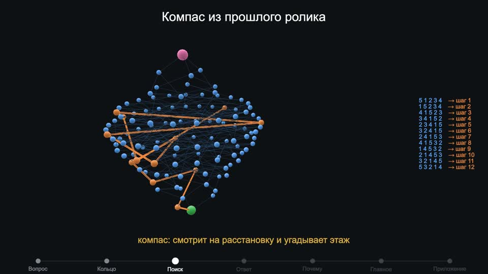
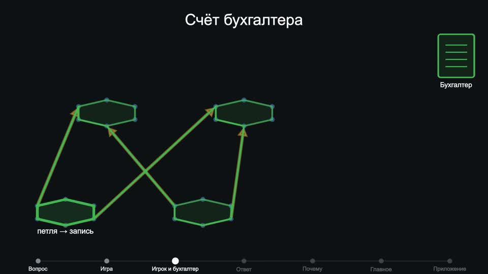
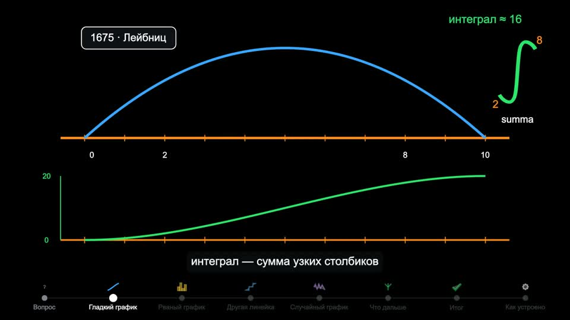
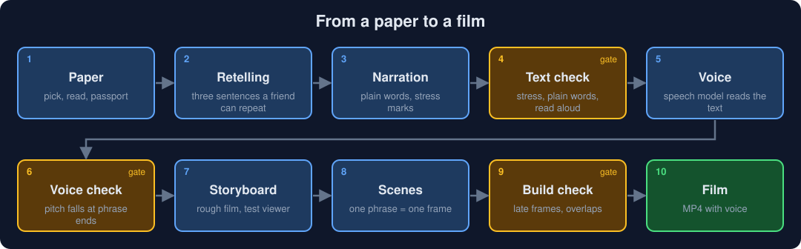
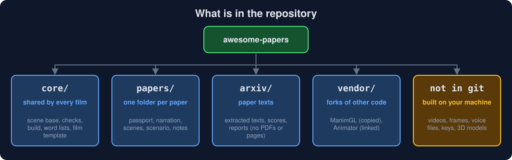

# awesome-papers

**English** | [Русский](README.ru.md)

Short explainer films about fresh scientific papers, told in plain words. Every film is animated from code, voiced by a speech model and checked by programs before it is built. A viewer needs no background: only school maths for the maths films.

The films are in Russian. This page is in English; the same page in Russian is [README.ru.md](README.ru.md).

| | |
|---|---|
|  |  |
| Film on large Rubik's cubes: every position is a room in a maze | Film on a ring of balls: a compass guesses how far an arrangement is from solved |
|  |  |
| Film on a relation gap: the accountant's loop against the player's count | Film on the history of the integral: area as a sum of thin columns |

## Contents

- [Films](#films)
- [How a film is made](#how-a-film-is-made)
- [What is in the repository](#what-is-in-the-repository)
- [Quick start](#quick-start)
- [Make a new film](#make-a-new-film)
- [Third-party code and licenses](#third-party-code-and-licenses)

## Films

Channel: [Digital nomads asia on YouTube](https://www.youtube.com/@jaiora-me). Community: [jaiora.me](https://jaiora.me). Blog: [urvanov.com](https://www.urvanov.com).

### Published

| Film | Paper | Watch and read | Folder |
|---|---|---|---|
| How many rules does a game need? Can the fast count of an accountant give fewer rules than the honest count of a player? | [arXiv 2610.23637](https://arxiv.org/abs/2610.23637): L. Bartholdi, M. R. Bridson, R. Mikhailov, J. Nicholson, "Two-generator presentations with a relation gap" (October 2026) | [YouTube](https://youtu.be/yPvbfDa_GCk) | [papers/2610.23637-relation-gap](papers/2610.23637-relation-gap) |
| Can a short solution of a huge Rubik's cube be found without trying every position? | [arXiv 2502.13266](https://arxiv.org/abs/2502.13266): Chervov, Khoruzhii et al. (CayleyPy), "A Machine Learning Approach That Beats Large Rubik's Cubes" (February 2025) | [YouTube](https://youtu.be/bg7tVawVWMc), blog post in [Russian](https://www.urvanov.com/blog/rubik-cube-neural-network/) and [English](https://www.urvanov.com/en/blog/rubik-cube-neural-network/) | [papers/2502.13266-rubik](papers/2502.13266-rubik) |
| Which arrangement of balls on a ring takes longest to untangle, and how many moves does it need? | [arXiv 2502.18663](https://arxiv.org/abs/2502.18663): Chervov, Obozov et al. (CayleyPy, 34 authors), "CayleyPy RL: Pathfinding and Reinforcement Learning on Cayley Graphs" (February 2025) | [YouTube](https://youtu.be/ecc2GvvZGvM), blog post in [Russian](https://www.urvanov.com/blog/longest-ring-arrangement/) and [English](https://www.urvanov.com/en/blog/longest-ring-arrangement/) | [papers/2502.18663-ring](papers/2502.18663-ring) |

### Built, not published yet

| Film | Paper or topic | Folder |
|---|---|---|
| How many manoeuvres does the most tangled train need? A sorting-yard world; hundreds of conjectures about the worst case | [arXiv 2509.19162](https://arxiv.org/abs/2509.19162): Chervov, Fedoriaka, Konstantinova et al. (CayleyPy, 49 authors), "CayleyPy Growth" (September 2025) | [papers/2509.19162-growth](papers/2509.19162-growth) |
| How to add up infinitely many thin columns: the history of the integral, by date, from Archimedes to Hairer | Topic, not a single paper | [papers/integrals-film](papers/integrals-film) |

### Early drafts

Built before the script rules existed; to be redone from the film template.

| Paper | Folder |
|---|---|
| [arXiv 2610.22161](https://arxiv.org/abs/2610.22161): P. Lank, "Gluing weak approximability along recollements" | [papers/2610.22161-weak-approx](papers/2610.22161-weak-approx) |
| [arXiv 2610.22128](https://arxiv.org/abs/2610.22128): B. Lamine et al., "The gravitational constant and the cosmic microwave background" | [papers/2610.22128-cmb](papers/2610.22128-cmb) |
| [arXiv 2610.00011](https://arxiv.org/abs/2610.00011): M. Tierz, "Critical Free-Energy Variance in the Sherrington-Kirkpatrick Model" | [papers/2610.00011-spin-glass](papers/2610.00011-spin-glass) |
| [arXiv 2610.28763](https://arxiv.org/abs/2610.28763): M. Zhong, S. Li, N. Carlini, M. Jagielski, "Automating ML for Science: Can Frontier Agents Climb Scientific Hills in the Wild?" (infographic only) | [papers/2610.28763-agent4sci](papers/2610.28763-agent4sci) |
| Grothendieck, [EGA I "The language of schemes"](https://www.numdam.org/item/PMIHES_1960__4__5_0.pdf) (1960): a sketch of a film | [papers/ega1-film](papers/ega1-film) |

## How a film is made



- Each amber step is a gate: a program checks the result, and the next step does not start until the check passes.
- The script follows fixed rules: one world for the whole film, one hero, history in date order, every named thing is drawn, every number is read off the picture. The rules and the history of the author's remarks are in [PLAYBOOK.md](PLAYBOOK.md) (in Russian).
- Voice: an OpenAI speech model by default (the narration text is sent to OpenAI for this); a free local Russian voice, Silero, is the fallback.
- Animation: [ManimGL](https://github.com/3b1b/manim), the library behind the 3Blue1Brown films; 3D scenes are rendered with Blender.

## What is in the repository



| Place | What it holds |
|---|---|
| `core/manimkit/` | scene base (one phrase = one frame), drawing helpers, style |
| `core/pipeline/` | passport check, text check, voice, voice check, storyboard, build |
| `core/lang/` | registers of stress marks and plain words, shared by all films |
| `core/templates/paper/` | template of a new film |
| `papers/<arxiv-id>-<word>/` | passport, narration, scenes, scenario and notes of one film |
| `arxiv/` | texts of the papers screened for films, scores and reports; page copies and PDFs are not stored |
| `vendor/` | ManimGL (copy with our fixes) and Animator (link to a fork) |
| `assets/MANIFEST.md` | list of 3D models and textures with sources and licenses; the files themselves are not stored |

Not in git: `videos/` (films, frames, voice files), `.env.local` (keys), `assets/` files and Python environments. They are built or downloaded again.

## Quick start

Needs [uv](https://docs.astral.sh/uv/) and [ffmpeg](https://ffmpeg.org/). Blender is needed only for 3D scenes.

```bash
git clone --recurse-submodules https://github.com/esurvanov/awesome-papers
cd awesome-papers
uv sync                                                                      # Python 3.12, everything in .venv
uv run python core/pipeline/check_passport.py papers/2610.23637-relation-gap # script rules
uv run python core/pipeline/build.py papers/2610.23637-relation-gap          # film with voice -> videos/
uv run manimgl papers/2610.23637-relation-gap/scenes.py A04 -s -w --video_dir videos/frames   # one scene as a picture
```

The OpenAI voice needs `OPENAI_API_KEY` in `.env.local`; without it use the local voice.

## Make a new film

```bash
cp -R core/templates/paper papers/<arxiv-id>-<word>
```

Then follow [PLAYBOOK.md](PLAYBOOK.md): read the paper, fill in the passport, check it with the author, write the narration, voice it, draw the scenes, build.

## Third-party code and licenses

The code and texts of this repository are under the [MIT license](LICENSE). Third-party parts below keep their own licenses. Finished films, frames and voice files are not in the repository and are not covered by it.

| What | Source | License | How it is used |
|---|---|---|---|
| ManimGL | [3b1b/manim](https://github.com/3b1b/manim), 3Blue1Brown LLC | MIT | copy of the sources with fixes, listed in `vendor/manim/UPSTREAM.md` |
| Animator | [ashishjamarkattel/Animator](https://github.com/ashishjamarkattel/Animator), Ashish Jamarkattel | none stated | fork [esurvanov/Animator](https://github.com/esurvanov/Animator) as a nested repository; its code is not copied here |
| CRAFT text detector (inside Animator) | [clovaai/CRAFT-pytorch](https://github.com/clovaai/CRAFT-pytorch), NAVER Corp. | code MIT; weights license not stated | part of the Animator fork |
| STORM (`knowledge-storm`) | [stanford-oval/storm](https://github.com/stanford-oval/storm), Stanford OVAL | MIT | separate environment, called by `core/pipeline/research.py`; code not copied |
| Humanizer | [blader/humanizer](https://github.com/blader/humanizer), Siqi Chen | MIT | copy of `SKILL.md` in `core/skills/humanizer/`, source in `SOURCE.md` there |
| 3D models and textures | Poly Haven (CC0), Sketchfab authors (CC BY 4.0) | see [assets/MANIFEST.md](assets/MANIFEST.md) | downloaded by the list, not stored; films that use them credit the authors |

While Animator has no license, its code lives only in the fork on GitHub. Copying its sources into this repository waits until its author adds a license.
