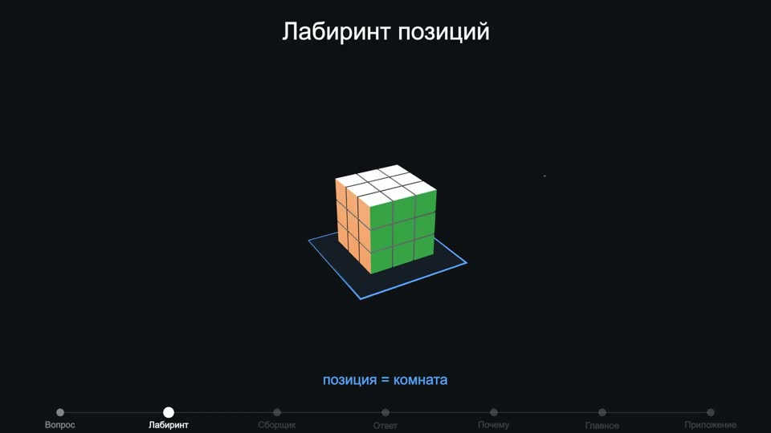
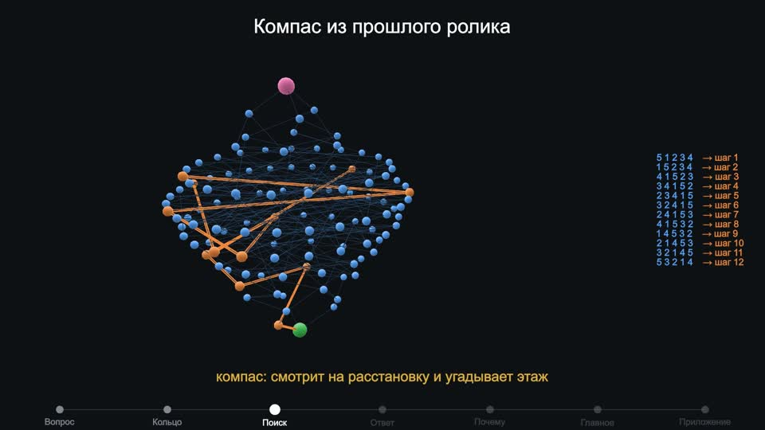
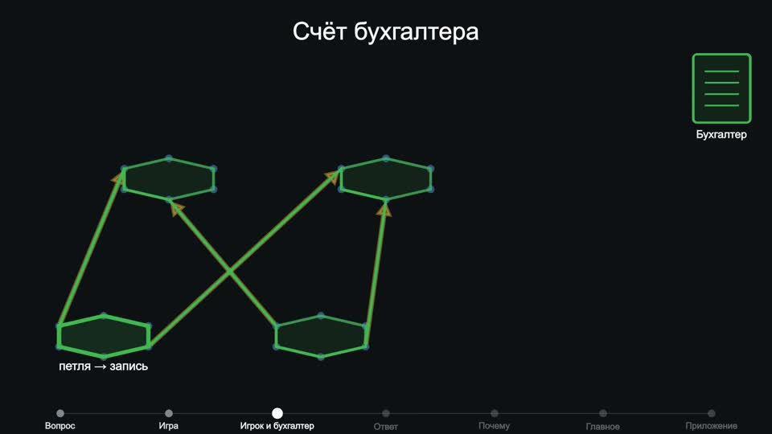
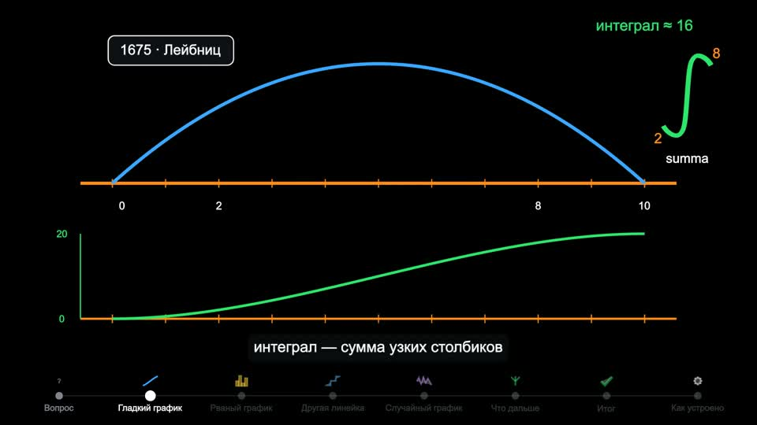
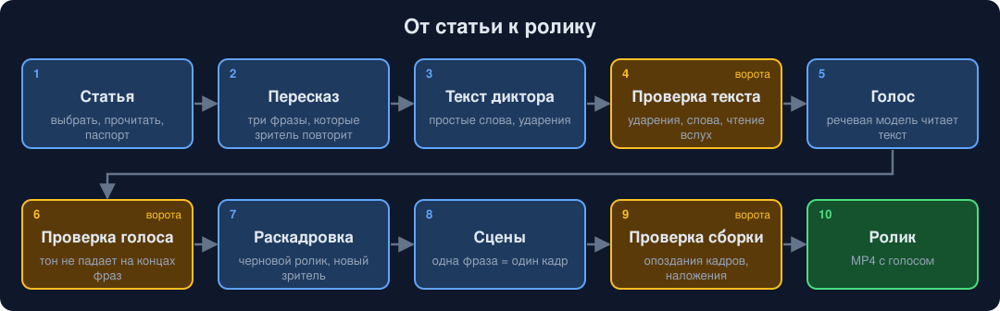
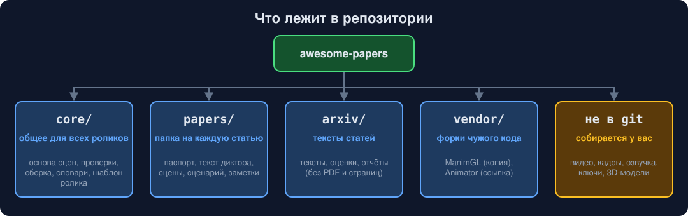

# awesome-papers

[English](README.md) | **Русский**

Короткие ролики о свежих научных статьях «простыми словами». Каждый ролик нарисован кодом, озвучен речевой моделью и до сборки проходит проверки программами. Зрителю не нужна подготовка: для роликов по математике хватает школьного курса.

Ролики на русском. Эта страница на русском; такая же страница на английском — [README.md](README.md).

| | |
|---|---|
|  |  |
| Ролик про большие кубики Рубика: каждая позиция — комната в лабиринте | Ролик про кольцо с шариками: компас угадывает, как далеко расстановка от собранной |
|  |  |
| Ролик про разрыв соотношений: петля бухгалтера против счёта игрока | Ролик про историю интеграла: площадь как сумма тонких столбиков |

## Содержание

- [Ролики](#ролики)
- [Как делается ролик](#как-делается-ролик)
- [Что лежит в репозитории](#что-лежит-в-репозитории)
- [Быстрый старт](#быстрый-старт)
- [Новый ролик](#новый-ролик)
- [Сторонний код и лицензии](#сторонний-код-и-лицензии)

## Ролики

Канал: [Digital nomads asia на YouTube](https://www.youtube.com/@jaiora-me). Сообщество: [jaiora.me](https://jaiora.me). Блог: [urvanov.com](https://www.urvanov.com).

### Опубликованы

| Ролик | Статья | Смотреть и читать | Папка |
|---|---|---|---|
| Сколько правил нужно, чтобы описать игру? Может ли быстрый счёт бухгалтера дать меньше правил, чем честный счёт игрока? | [arXiv 2610.23637](https://arxiv.org/abs/2610.23637): L. Bartholdi, M. R. Bridson, R. Mikhailov, J. Nicholson, «Two-generator presentations with a relation gap» (октябрь 2026) | [YouTube](https://youtu.be/yPvbfDa_GCk), статья в блоге: [по-русски](https://www.urvanov.com/blog/relation-gap-how-many-rules/) и [по-английски](https://www.urvanov.com/en/blog/relation-gap-how-many-rules/) | [papers/2610.23637-relation-gap](papers/2610.23637-relation-gap) |
| Можно ли найти короткую сборку огромного кубика Рубика, не перебирая все позиции? | [arXiv 2502.13266](https://arxiv.org/abs/2502.13266): Chervov, Khoruzhii и др. (CayleyPy), «A Machine Learning Approach That Beats Large Rubik's Cubes» (февраль 2025) | [YouTube](https://youtu.be/bg7tVawVWMc), статья в блоге: [по-русски](https://www.urvanov.com/blog/rubik-cube-neural-network/) и [по-английски](https://www.urvanov.com/en/blog/rubik-cube-neural-network/) | [papers/2502.13266-rubik](papers/2502.13266-rubik) |
| Какую расстановку шариков на кольце распутывать дольше всех и сколько на неё нужно ходов? | [arXiv 2502.18663](https://arxiv.org/abs/2502.18663): Chervov, Obozov и др. (CayleyPy, 34 автора), «CayleyPy RL: Pathfinding and Reinforcement Learning on Cayley Graphs» (февраль 2025) | [YouTube](https://youtu.be/ecc2GvvZGvM), статья в блоге: [по-русски](https://www.urvanov.com/blog/longest-ring-arrangement/) и [по-английски](https://www.urvanov.com/en/blog/longest-ring-arrangement/) | [papers/2502.18663-ring](papers/2502.18663-ring) |

### Собраны, ещё не опубликованы

| Ролик | Статья или тема | Папка |
|---|---|---|
| Сколько манёвров нужно на самый запутанный состав? Мир — сортировочная станция; сотни гипотез о худшем случае | [arXiv 2509.19162](https://arxiv.org/abs/2509.19162): Chervov, Fedoriaka, Konstantinova и др. (CayleyPy, 49 авторов), «CayleyPy Growth» (сентябрь 2025) | [papers/2509.19162-growth](papers/2509.19162-growth) |
| Как сложить бесконечно много тонких столбиков: история интеграла по датам, от Архимеда до Хайрера | Тема, не одна статья | [papers/integrals-film](papers/integrals-film) |

### Ранние черновики

Собраны до появления правил сценария; их предстоит переделать по шаблону ролика.

| Статья | Папка |
|---|---|
| [arXiv 2610.22161](https://arxiv.org/abs/2610.22161): P. Lank, «Gluing weak approximability along recollements» | [papers/2610.22161-weak-approx](papers/2610.22161-weak-approx) |
| [arXiv 2610.22128](https://arxiv.org/abs/2610.22128): B. Lamine и др., «The gravitational constant and the cosmic microwave background» | [papers/2610.22128-cmb](papers/2610.22128-cmb) |
| [arXiv 2610.00011](https://arxiv.org/abs/2610.00011): M. Tierz, «Critical Free-Energy Variance in the Sherrington-Kirkpatrick Model» | [papers/2610.00011-spin-glass](papers/2610.00011-spin-glass) |
| [arXiv 2610.28763](https://arxiv.org/abs/2610.28763): M. Zhong, S. Li, N. Carlini, M. Jagielski, «Automating ML for Science: Can Frontier Agents Climb Scientific Hills in the Wild?» (только инфографика) | [papers/2610.28763-agent4sci](papers/2610.28763-agent4sci) |
| Гротендик, [EGA I «Язык схем»](https://www.numdam.org/item/PMIHES_1960__4__5_0.pdf) (1960): набросок ролика | [papers/ega1-film](papers/ega1-film) |

## Как делается ролик



- Жёлтый шаг — ворота: программа проверяет результат, и следующий шаг не начнётся, пока проверка не пройдена.
- Сценарий подчиняется твёрдым правилам: один мир на весь ролик, один герой, история по датам, всё названное нарисовано, каждое число читается с рисунка. Правила и история замечаний автора — в [PLAYBOOK.md](PLAYBOOK.md).
- Голос: по умолчанию речевая модель OpenAI (текст диктора для этого уходит в OpenAI); запасной вариант — бесплатный локальный русский голос Silero.
- Анимация: [ManimGL](https://github.com/3b1b/manim), библиотека, на которой сделаны ролики 3Blue1Brown; трёхмерные сцены рисует Blender.

## Что лежит в репозитории



| Место | Что внутри |
|---|---|
| `core/manimkit/` | основа сцен (одна фраза = один кадр), помощники рисунка, стиль |
| `core/pipeline/` | проверка паспорта, проверка текста, голос, проверка голоса, раскадровка, сборка |
| `core/lang/` | реестры ударений и обыденных слов, общие для всех роликов |
| `core/templates/paper/` | шаблон нового ролика |
| `papers/<arxiv-id>-<слово>/` | паспорт, текст диктора, сцены, сценарий и заметки одного ролика |
| `arxiv/` | тексты статей, отобранных для роликов, оценки и отчёты; страницы и PDF не хранятся |
| `vendor/` | ManimGL (копия с нашими правками) и Animator (ссылка на форк) |
| `assets/MANIFEST.md` | список 3D-моделей и текстур с источниками и лицензиями; сами файлы не хранятся |

Не в git: `videos/` (ролики, кадры, озвучка), `.env.local` (ключи), файлы `assets/` и окружения Python. Их собирают или скачивают заново.

## Быстрый старт

Нужны [uv](https://docs.astral.sh/uv/) и [ffmpeg](https://ffmpeg.org/). Blender нужен только для трёхмерных сцен.

```bash
git clone --recurse-submodules https://github.com/esurvanov/awesome-papers
cd awesome-papers
uv sync                                                                      # Python 3.12, всё в .venv
uv run python core/pipeline/check_passport.py papers/2610.23637-relation-gap # правила сценария
uv run python core/pipeline/build.py papers/2610.23637-relation-gap          # ролик с голосом -> videos/
uv run manimgl papers/2610.23637-relation-gap/scenes.py A04 -s -w --video_dir videos/frames   # кадр одной сцены
```

Для голоса OpenAI нужен `OPENAI_API_KEY` в `.env.local`; без него берут локальный голос.

## Новый ролик

```bash
cp -R core/templates/paper papers/<arxiv-id>-<слово>
```

Дальше — по [PLAYBOOK.md](PLAYBOOK.md): прочитать статью, заполнить паспорт, сверить с автором, написать текст диктора, озвучить, нарисовать сцены, собрать.

## Сторонний код и лицензии

Код и тексты этого репозитория — под [лицензией MIT](LICENSE). Сторонние части ниже сохраняют свои лицензии. Готовые ролики, кадры и озвучка в репозитории не лежат и под неё не подпадают.

| Что | Откуда | Лицензия | Как подключено |
|---|---|---|---|
| ManimGL | [3b1b/manim](https://github.com/3b1b/manim), 3Blue1Brown LLC | MIT | копия исходников с правками, список — в `vendor/manim/UPSTREAM.md` |
| Animator | [ashishjamarkattel/Animator](https://github.com/ashishjamarkattel/Animator), Ashish Jamarkattel | не указана | форк [esurvanov/Animator](https://github.com/esurvanov/Animator) вложенным репозиторием; код сюда не копируется |
| Детектор текста CRAFT (внутри Animator) | [clovaai/CRAFT-pytorch](https://github.com/clovaai/CRAFT-pytorch), NAVER Corp. | код MIT; лицензия весов не указана | часть форка Animator |
| STORM (`knowledge-storm`) | [stanford-oval/storm](https://github.com/stanford-oval/storm), Stanford OVAL | MIT | отдельное окружение, вызывается из `core/pipeline/research.py`; код не копируется |
| Humanizer | [blader/humanizer](https://github.com/blader/humanizer), Siqi Chen | MIT | копия `SKILL.md` в `core/skills/humanizer/`, источник — `SOURCE.md` там же |
| 3D-модели и текстуры | Poly Haven (CC0), авторы Sketchfab (CC BY 4.0) | см. [assets/MANIFEST.md](assets/MANIFEST.md) | скачиваются по списку, не хранятся; ролики с ними указывают авторов |

Пока у Animator нет лицензии, его код живёт только в форке на GitHub. Переносить его исходники в этот репозиторий можно после того, как автор добавит лицензию.
